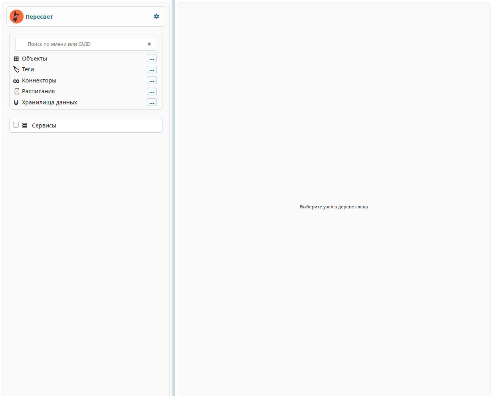
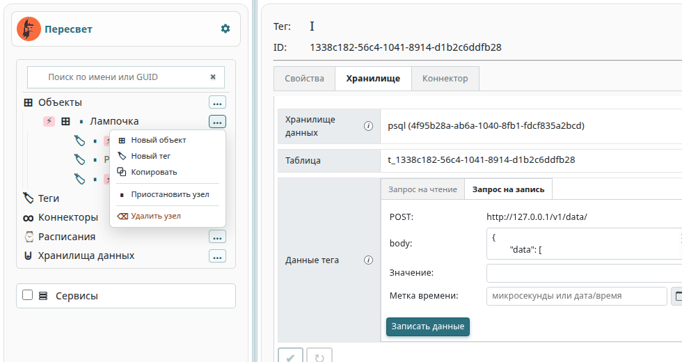
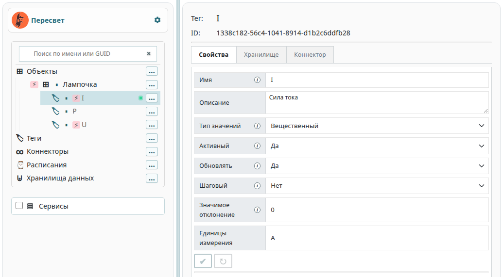
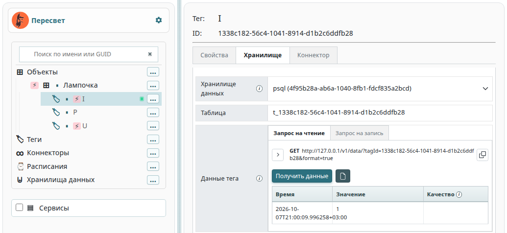
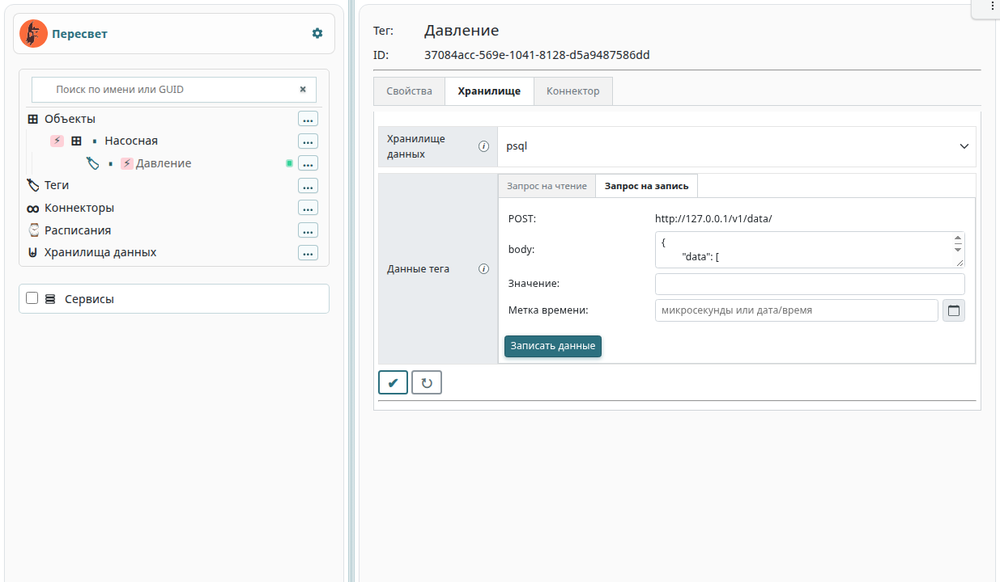
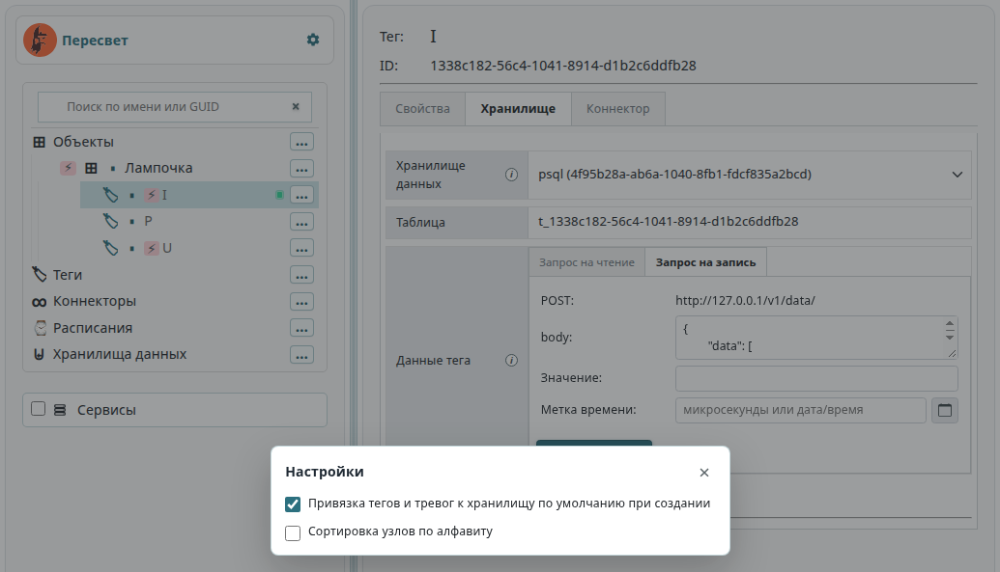

.. _configurator:

Конфигуратор модели
-------------------

Конфигуратор — главная панель Grafana и основной инструмент работы
с моделью. В нём создают и настраивают объекты, теги, тревоги, методы,
коннекторы, расписания и хранилища данных, читают и пишут значения тегов,
следят за тревогами и смотрят журналы сервисов платформы.

Всё, что делает конфигуратор, он делает через :ref:`HTTP API <api>`
платформы. Любое действие в нём можно повторить запросом из своей
программы.

Как открыть
^^^^^^^^^^^

Запустите платформу (:ref:`installation`) и откройте в браузере
``https://<адрес из PRS_IP>/grafana``. На самом сервере работает и
``https://localhost/grafana``. Сертификат самоподписанный, поэтому браузер
покажет предупреждение — подтвердите переход.

При первом входе имя и пароль — ``admin`` / ``admin``. Grafana предложит
сменить пароль.

   Слева дерево модели, справа свойства выбранного узла.

Экран разделён на две колонки. Слева — дерево модели и под ним блок
«Сервисы» с журналами платформы. Справа — свойства узла, выбранного
в дереве. Границы между колонками и между деревом и блоком «Сервисы»
двигаются мышью: это тонкая линия с ручкой посередине.

Над деревом стоит надпись «Пересвет». Под ней мелким шрифтом показана
версия платформы, сама надпись открывает эту документацию, шестерёнка
рядом — настройки (см. `Настройки`_).

Дерево модели
^^^^^^^^^^^^^

Корневые папки
______________

На верхнем уровне дерева лежат служебные папки, по одной на вид
сущностей:

.. list-table::
   :header-rows: 1
   :widths: 24 76

   * - Папка
     - Что в ней
   * - Объекты
     - Основная иерархия модели: объекты, в них — вложенные объекты
       и теги, у тегов — тревоги и методы.
   * - Теги
     - Теги, не привязанные к объектам. Удобно, если модель — просто
       список параметров.
   * - Коннекторы
     - Программы, которые приносят данные с оборудования
       (:ref:`connectors_guide`), в том числе видеокамеры
       (:ref:`video_cameras`).
   * - Расписания
     - Генераторы событий по времени (:ref:`schedules_guide`).
   * - Методы
     - Каталог методов: общие определения, на которые ссылаются теги
       и тревоги (:doc:`../methods`).
   * - Хранилища данных
     - Базы, куда пишутся история тегов и эпизоды тревог
       (:ref:`storages_guide`).

Пользовательские папки
______________________

Чтобы разложить узлы по группам, создайте папку командой «Новая папка».
Она есть в меню корневых папок, объекта и другой пользовательской папки.
Что можно положить в папку, зависит от ветки, в которой она лежит:

* в ветке «Объекты» — папки, объекты и теги;
* в ветке «Теги» — папки и теги;
* в остальных ветках — папки и узлы этой ветки: коннекторы, расписания,
  хранилища или методы каталога.

Папки влияют только на вид дерева: тег в папке пишет и читает данные так
же, как без неё. Удаление папки удаляет и всё её содержимое.

Порядок и поиск
_______________

Внутри одного родителя узлы сначала группируются по виду: папки, объекты,
теги, тревоги, методы, коннекторы, расписания, хранилища. Внутри вида
порядок задаёт индекс узла (атрибут ``prsIndex``); в настройках можно
включить сортировку по имени.

Поле «Поиск по имени или GUID» над деревом ищет узлы по имени или
идентификатору. Выбор найденной строки раскрывает ветку до этого узла
и выделяет его. Подсказка на имени любого узла показывает его описание.

.. _configurator_marks:

Пометки в дереве
________________

Конфигуратор помечает узлы, с которыми что-то не так. Пометка стоит слева
от имени — проблема у самого узла, или справа, перед кнопкой меню, —
проблема где-то ниже по ветке. Пометка справа поднимается до самого
верхнего объекта, в том числе через папки, но не на корневые папки.
Нажатие на пометку открывает список проблем.

.. list-table::
   :header-rows: 1
   :widths: 26 74

   * - Пометка
     - Что означает
   * - Перечёркнутый круг
     - Тег или тревога не привязаны к хранилищу: история не пишется.
   * - Молния
     - У тега нет источника данных: ни коннектора, ни дочернего метода.
       Пометку можно отключить в настройках.
   * - Восклицательный знак
     - Тег привязан к хранилищу и при этом имеет метод чтения или записи.
       Отвечать на запрос будут оба, и платформа возьмёт первый ответ
       (см. :doc:`../methods`).
   * - Бирка с крестом
     - У метода есть параметр «Данные тега(-ов)», в котором не выбран тег.
   * - Кружок с крестом
     - У вычислительного метода тега или тревоги не выбран ни один
       инициатор, и он никогда не запустится.
   * - Пауза
     - Узел выключен (признак «Активный» снят). Имя такого узла бледнее.
   * - Кружок у коннектора
     - Связь с коннектором: зелёный — на связи, красный — нет, серый —
       состояние ещё не получено. Обновляется примерно раз в пять секунд.
       У камеры кружок зелёный, пока сервис захвата видео держит
       соединение с ней.
   * - Пульсирующий красный кружок
     - В узле или ниже по ветке есть тревога, требующая внимания: активная
       или пропавшая, но не квитированная (см. `Тревоги`_).

Своя пометка стоит и у хранилища по умолчанию.

Цвет значка тега показывает, какие у тега методы:

.. list-table::
   :header-rows: 1
   :widths: 20 80

   * - Цвет
     - Что означает
   * - Зелёный
     - Обычный тег: методов чтения, записи и вычисления нет.
   * - Оранжевый
     - Есть вычислительный метод (тип ``0``).
   * - Бирюзовый
     - Есть метод записи (тип ``2``).
   * - Фиолетовый
     - Есть метод чтения (тип ``1``) — с методом записи или без него.

Методы «Действие при чтении» и «Действие при записи» (типы ``3`` и ``4``)
цвет не меняют.

Перетаскивание
______________

Объекты, теги, коннекторы, расписания, хранилища и пользовательские папки
переносят мышью: узел, отпущенный на объект или папку, становится его
потомком. Корневые папки не перетаскиваются, а перенести узел внутрь
его собственной ветки нельзя.

Можно перенести сразу несколько узлов одного вида:

* ``Ctrl`` (на macOS — ``Cmd``) добавляет строку к выделению;
* ``Shift`` выделяет диапазон соседних узлов того же вида;
* перетаскивание любой выделенной строки переносит всю группу;
* обычный щелчок снимает выделение.

Команды узла
^^^^^^^^^^^^

Кнопка «…» справа в строке узла открывает меню команд. В меню только те
команды, которые допустимы для этого узла.

.. list-table::
   :header-rows: 1
   :widths: 30 70

   * - Узел
     - Команды
   * - Папка «Объекты»
     - Новая папка, новый объект
   * - Объект
     - Новая папка, новый объект, новый тег, копировать, приостановить,
       удалить
   * - Пользовательская папка
     - Новая папка и узлы, допустимые в этой ветке; приостановить, удалить
   * - Папка «Теги»
     - Новая папка, новый тег
   * - Тег
     - Новая тревога, новый метод, копировать, приостановить, удалить
   * - Тревога
     - Новый метод, копировать, приостановить, удалить
   * - Папка «Методы» и папки внутри неё
     - Новая папка, новый метод, загрузка описания; у вложенных папок
       ещё приостановить, удалить
   * - Метод
     - Копировать, приостановить, удалить
   * - Папка «Коннекторы»
     - Новая папка, новый коннектор
   * - Коннектор
     - Приостановить, удалить
   * - Папка «Расписания»
     - Новая папка, новое расписание
   * - Расписание
     - Приостановить, удалить
   * - Папка «Хранилища данных»
     - Новая папка, новое хранилище
   * - Хранилище
     - Приостановить, удалить
   * - Привязка тега к коннектору или хранилищу
     - Перейти к тегу, удалить

Кроме того, в меню каждого узла есть команда **Тревоги**
(см. `Тревоги`_).

**Новый узел** создаётся с настройками по умолчанию и именем, равным его
идентификатору. Его свойства сразу открываются справа — там узел
и переименовывают.

**Копировать** создаёт копию узла со всеми потомками рядом с исходным.
Если имя занято, к нему добавляется «(копия)». Для объекта конфигуратор
сначала спрашивает имя копии.

**Приостановить** и **Включить** снимают и ставят признак «Активный»
у узла и у тех его потомков, которые раскрыты в дереве. Нераскрытые ветки
не затрагиваются: перед приостановкой раскройте всё, что нужно выключить.

**Удалить** удаляет узел со всеми потомками.

Копирование, приостановка и удаление требуют подтверждения. Закрыть меню
можно клавишей ``Escape`` или щелчком мимо него.

Свойства узла
^^^^^^^^^^^^^

Правая колонка показывает имя, идентификатор и поля выбранного узла.
Имя, описание и признак «Активный» есть почти у всех узлов, остальные
поля зависят от вида узла:

.. list-table::
   :header-rows: 1
   :widths: 22 78

   * - Узел
     - Поля
   * - Объект
     - Индекс, код типа, конфигурация.
   * - Тег
     - Тип значений (целый, вещественный, строковый, JSON, интеграционный,
       видеопоток), «Обновлять», «Шаговый», значимое отклонение, единицы
       измерения, конфигурация. Что значат эти поля — в справочнике
       :doc:`../tags`.
   * - Тревога
     - Условие (значение тега ``>=`` порога или ``<`` порога), порог
       и квитирование: ручное или автоматическое (:ref:`alerts_guide`).
   * - Метод
     - См. `Методы`_.
   * - Коннектор
     - Конфигурация, флажок «Лог в платформу», журнал и команды
       (см. `Коннектор: журнал и команды`_).
   * - Расписание
     - Начало, конец и шаг (:ref:`schedules_guide`).
   * - Хранилище данных
     - Признак «по умолчанию», код типа, конфигурация
       (:ref:`storages_guide`).

Изменённое поле выделяется бирюзовой рамкой. Под формой две кнопки:
галочка записывает изменения в платформу, круглая стрелка отменяет их
и заново читает узел из платформы.

Рядом с подписью поля стоят значки: подсказка (есть у каждого поля),
ссылка на документацию и у некоторых полей — копирование значения.
Имя и идентификатор узла копируются кнопками в заголовке.

**Конфигурация** — редактор JSON с нумерацией строк. Если в JSON есть
ошибка, редактор подсвечивает строку и показывает, где ошибка; пока
ошибка не исправлена, узел не записывается. Кнопки над полем форматируют
JSON и отменяют правки в поле.

**Признак «Активный»** при записи меняется только у этого узла. Чтобы
выключить ветку целиком, используйте команду «Приостановить».

Тег: данные, хранилище и коннектор
^^^^^^^^^^^^^^^^^^^^^^^^^^^^^^^^^^^^^^

У тега справа есть вкладки **Данные**, **Хранилище** и **Коннектор**,
у тревоги — только **Хранилище**.

Вкладка «Данные»
________________

Блок «Данные тега» читает и пишет значения тега прямо из конфигуратора.
Вкладка есть у каждого тега: значения могут приходить из хранилища
или из метода чтения, привязка к хранилищу для этого блока не нужна.
У тега «Видеопоток» здесь же открывается просмотр камеры
(:ref:`video_cameras`).

Вкладка «Хранилище»
___________________

Здесь выбирают хранилище, в которое пишутся история тега или эпизоды
тревоги. Узел привязывается к одному хранилищу: выбор другого отвязывает
его от прежнего.

.. warning::

   При отвязке PostgreSQL удаляет таблицу с историей. Смена хранилища
   историю не переносит: в прежнем хранилище она пропадает.

У тревоги на этой вкладке лежит блок «Данные тревоги» (см. `Тревоги`_).

Тег «Видеопоток» привязывают к коннектору-камере и к хранилищу видео,
а не к хранилищу истории.

Вкладка «Коннектор»
___________________

Здесь выбирают коннектор, от которого тег получает данные, и задают
параметры привязки в JSON: адрес значения в источнике, выражение JSONata,
значимое отклонение, период опроса (:ref:`connectors_guide`). Формат
ключа ``source`` задаёт конкретный коннектор. Кнопка записи сохраняет
и свойства тега, и привязку.

Данные тега
___________

Блок «Данные тега» на вкладке **Данные** читает и пишет значения тега.

**Чтение.** Поля блока — это ключи запроса
:ref:`исторических данных <historical_data>`: ``format``, ``actual``,
``start``, ``finish``, ``count``, ``value``, ``timeStep``, ``maxCount``.
У каждого есть подсказка и ссылка на описание. ``format`` включён
по умолчанию: метки времени приходят строками ISO 8601. Для ``start``
и ``finish`` есть календарь; в эти поля можно вставить дату, скопированную
из таблицы ответа. У интеграционного тега есть ещё поле ``params``
(:ref:`integrational_v2`).

Над полями показан готовый запрос ``GET``, кнопка рядом копирует его.
Значок **Читать данные** выполняет запрос и выводит таблицу
«Время / Значение / Качество». Коды качества описаны в разделе
:ref:`qualityCodes`.

**Запись.** Задайте значение и, если нужно, метку времени. Пустая метка
означает текущий момент; метку можно указать целым числом микросекунд
или датой со временем. Тело запроса ``POST /v1/data/`` собирается
по мере ввода, значение приводится к типу тега. Значок **Записать данные**
отправляет запрос. У видеопотока записи нет.

**Экспорт в CSV.** После успешного чтения доступна кнопка
**Сохранить в CSV**. Файл называется ``<имя тега> :: <дата и время>.csv``.
В начале файла — имя и идентификатор тега и полный запрос, затем строка
заголовка ``x,y,q`` и сами точки. Если запрос содержит что-то похожее
на пароль или токен, конфигуратор попросит подтвердить сохранение.
Любое изменение запроса очищает таблицу: экспорт снова станет доступен
после следующего чтения.

Методы
^^^^^^

Как устроены и пишутся методы, описано в разделе :doc:`../methods`.
Здесь — работа с ними в конфигураторе.

Метод создают командой **Новый метод** в меню тега или тревоги. Поле
«Метод/ссылка» в свойствах определяет, что это будет:

* **новый метод** — адрес, параметры и инициаторы задаются прямо у него;
* **ссылка на метод каталога** — адрес и список параметров берутся из
  определения в папке «Методы», которое выбирают в поле «Метод каталога».
  Адрес у ссылки не меняется.

Поле **Тип** задаёт, когда вызывается метод:

.. list-table::
   :header-rows: 1
   :widths: 8 26 66

   * - Код
     - Тип
     - Когда вызывается
   * - ``0``
     - Вычислительный
     - По событию инициатора: новому значению тега, срабатыванию
       расписания или выбранному событию тревоги. Результат пишется в тег.
   * - ``1``
     - Чтение
     - При чтении тега. Отвечает на чтение вместо хранилища.
   * - ``2``
     - Запись
     - При записи в тег. Принимает запись вместо хранилища.
   * - ``3``
     - Действие при чтении
     - При каждом чтении тега, но не отвечает на него.
   * - ``4``
     - Действие при записи
     - При каждой записи в тег, но не отвечает на неё.

Инициаторы
__________

Инициаторы — теги, расписания и тревоги, события которых запускают
вычислительный метод. Они разложены по трём вкладкам. Лупа открывает
поиск: узел ищут по имени, пути или идентификатору и отмечают сразу
несколько. Выбранные узлы стоят в списке рядом с лупой; повторный выбор
снимает отметку.

У каждой тревоги-инициатора свой набор событий: срабатывание, пропадание,
квитирование. По умолчанию — только срабатывание; снять все флажки
нельзя.

Пока у вычислительного метода нет ни одного инициатора, лупа красная,
блок «Инициаторы» и вкладка «Свойства» подсвечены розовым, а в дереве
у метода стоит кружок с крестом.

Параметры
_________

Параметры открываются вкладкой «Параметры» рядом со «Свойствами». Каждый
параметр — своя вкладка; в метод они передаются в порядке вкладок:
первая вкладка — первый аргумент. Имя параметра — подпись для человека,
при вызове учитывается только порядок.

Источник значения параметра:

* **Данные тега(-ов)** — запрос ``GET /v1/data/`` к выбранным тегам.
  Тегов может быть несколько, все попадают в один запрос. Пока тег
  не выбран, вкладка параметра подсвечена розовым;
* **Данные из запроса клиента** — запрос, которым клиент читает тег
  (для методов чтения);
* **Запрос к платформе** — ключ маршрутизации и сообщение внутреннему
  сервису платформы;
* **Внешний запрос** — произвольный HTTP(S)-запрос: метод, адрес,
  заголовки, тело.

К ответу любого источника можно применить выражение JSONata.

У источника «Данные тега(-ов)» поле **Запрос** — редактор тела запроса
в JSON. В него можно дописать любые ключи, например операцию
интеграционного тега. Стрелка раскрывает отдельные поля запроса
(у ``start`` и ``finish`` есть календарь). Под полем собирается адрес
запроса, а стрелка рядом с ним выполняет запрос и показывает ответ
платформы.

У ссылки на метод каталога число, имена и описания параметров берутся
из каталога — задают только источники. Если в определении включены
«Произвольные параметры», ссылка задаёт свой список, параметры добавляют
кнопкой «+».

Определение в каталоге
______________________

Метод в папке «Методы» — определение: адрес и список параметров (имя,
описание, порядок). Инициаторов и источников у определения нет.
Поле «Произвольные параметры»:

* «Нет» — список параметров задан в каталоге и одинаков у всех ссылок;
* «Да» — число параметров задаёт каждая ссылка.

Команда **Загрузка описания** в меню папки «Методы» загружает набор
папок и методов из файла YAML (:ref:`methods_yaml`).

.. _configurator_alarms:

Тревоги
^^^^^^^

Тревогу создают в меню тега, её свойства описаны в разделе
:ref:`alerts_guide`.

Кружок в дереве
_______________

Пульсирующий красный кружок означает, что в узле или ниже по ветке есть
тревога, требующая внимания: активная (квитированная или нет) или
пропавшая, но не квитированная. У самой тревоги кружок стоит после её
значка, у родителей — справа в строке. Когда таких тревог не остаётся,
кружок исчезает. Конфигуратор обновляет кружки примерно раз в пять
секунд.

Список тревог
_____________

Команда **Тревоги** в меню любого узла открывает справа вместо свойств
список тревог этой ветки. Щелчок по строке дерева закрывает список.

Сверху показан запрос ``GET /v1/alarms/``, по которому собран список,
и его ключи: ``parentId`` (выбранный узел, не меняется), ``getChildren``,
``format``, ``fired``, ``start``, ``finish``, ``count``. Смысл ключей
описан в справочнике :doc:`../alerts`. Изменение ключа сразу меняет
запрос, значок **Читать данные** выполняет его.

По умолчанию ``fired`` включён, и список показывает тревоги, активные
сейчас. Чтобы увидеть и пропавшие неквитированные, выключите ``fired``:
тогда в списке будет по строке на каждую тревогу ветки. Чтобы увидеть
историю эпизодов, задайте ещё ``start`` или ``count``.

В строке тревоги:

* имя тревоги и путь до неё, например ``Цех→Насос→Уровень``;
* состояние: «Активна, не квитирована», «Активна, квитирована» или
  «Пропала, не квитирована»;
* метки «Старт», «Финиш» и «Квитирование»;
* кнопка **Квитировать**, пока тревога не квитирована.

Щелчок по строке раскрывает тревогу в дереве и открывает её свойства.
Пока список открыт, он обновляется примерно раз в три секунды.

Данные тревоги
______________

На вкладке **Хранилище** тревоги лежит блок «Данные тревоги». Он устроен
так же, как блок «Данные тега», но читает эпизоды этой тревоги запросом
``GET /v1/alarms/`` с ключами ``format``, ``fired``, ``start``, ``finish``,
``count`` и выводит таблицу из трёх меток эпизода.

Расписания
^^^^^^^^^^

Расписание создают в меню папки «Расписания» и задают ему начало, конец
и шаг. Метод подписывается на расписание так же, как на тег: расписание
выбирают на вкладке «Расписания» его инициаторов. Подробно —
в разделе :ref:`schedules_guide`.

Коннектор: журнал и команды
^^^^^^^^^^^^^^^^^^^^^^^^^^^

Флажок **Лог в платформу** включает передачу журнала коннектора
в платформу. Ниже две вкладки.

**Лог коннектора** — последние строки журнала. Пауза останавливает
обновление на экране (платформа продолжает принимать строки), стрелка
вниз сохраняет видимый текст в файл.

**Команды коннектору** — команды оболочки, которые коннектор выполнит
на своей машине, по одной на строку. Под полем видны ответ платформы
и вывод, который вернул коннектор. Подробнее — в разделе
:ref:`connectors_guide`.

У камеры вкладки команд нет: поворотом и изображением управляют у тега
видеопотока (:ref:`video_cameras`).

Хранилища данных
^^^^^^^^^^^^^^^^

Папка «Хранилища данных» показывает справа карточки всех хранилищ. Под
каждым хранилищем в дереве перечислены привязанные к нему теги и
тревоги. Привязка названа путём до узла: объекты и папки до тега или
тревоги через стрелку ``→``. Саму привязку задают на вкладке
**Хранилище** тега или тревоги.

Щелчок по привязке открывает её параметры. У хранилища истории это
таблица, у видеоархива — каталог и срок хранения.

У привязки к интеграционному хранилищу задают операции чтения и записи:
имя, описание, выражения параметров и признак операции по умолчанию.
Первая созданная операция каждого вида сразу становится операцией
по умолчанию. Операции сохраняются отдельной кнопкой
**Записать операции (v2)** (:ref:`integrational_v2`).

В меню привязки две команды: **Перейти к тегу** раскрывает тег в дереве,
**Удалить** снимает привязку, не удаляя сам тег. Привязки тегов
к коннектору устроены так же.

Сервисы
^^^^^^^

Блок «Сервисы» под деревом показывает журналы процессов платформы.
Флажок в строке «Сервисы» отмечает сразу все сервисы. У каждого сервиса
есть свой флажок «Показывать лог сервиса» и число подключённых
обработчиков очереди. Справа выводятся последние строки журналов
отмеченных сервисов. Меню команд узла у этого списка нет: оно только
у дерева модели.

Пауза останавливает обновление на экране, корзина очищает журналы
выбранных сервисов, стрелка вниз сохраняет видимый текст в файл.

Настройки
^^^^^^^^^

Окно настроек открывает шестерёнка рядом с надписью «Пересвет» над
деревом. Настройки запоминаются в браузере.

.. list-table::
   :header-rows: 1
   :widths: 36 64

   * - Настройка
     - Что делает
   * - Привязка тегов и тревог к хранилищу по умолчанию при создании
     - Новый тег или новая тревога сразу привязываются к хранилищу
       по умолчанию. Тег «Видеопоток» к хранилищу истории
       не привязывается никогда.
   * - Сортировка узлов по алфавиту
     - Узлы одного вида сортируются по имени, а не по индексу.
   * - Отсутствие источника данных — не ошибка
     - Тег без коннектора и без метода не помечается молнией. Выключено
       по умолчанию.
   * - Размер шрифта
     - Базовый размер шрифта в пикселях, от 10 до 32, по умолчанию 16.

Дальше
^^^^^^

Модель с нуля по шагам собирается в
`базовом курсе <https://github.com/mp-co-ru/prs-peresvet-courses/tree/main/01.base>`_.
Подключение камеры — в разделе :ref:`video_cameras`.
