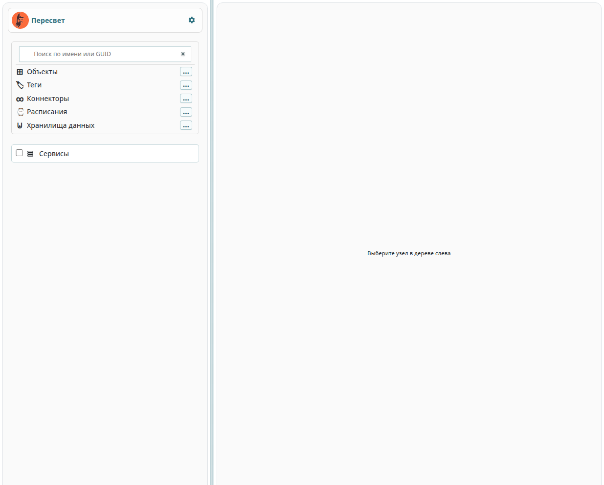
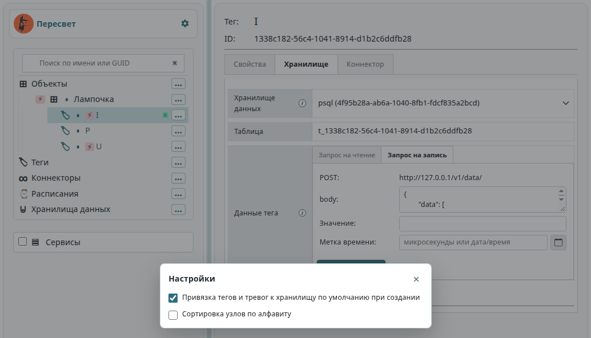
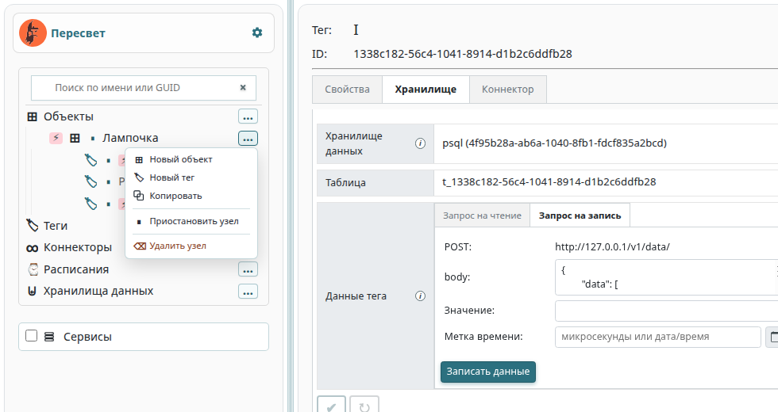
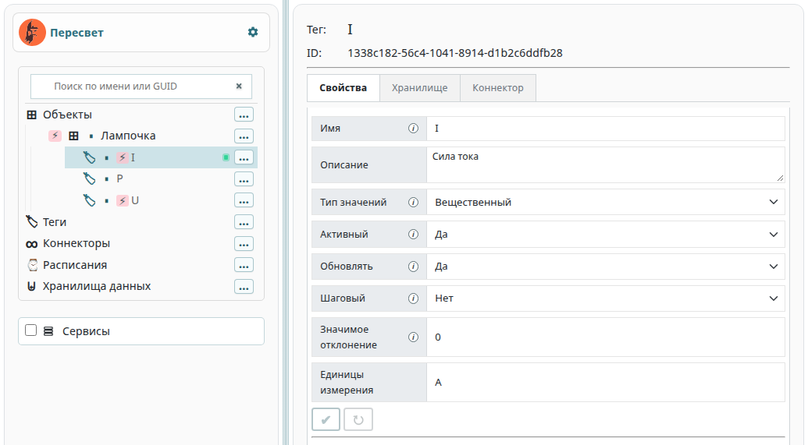
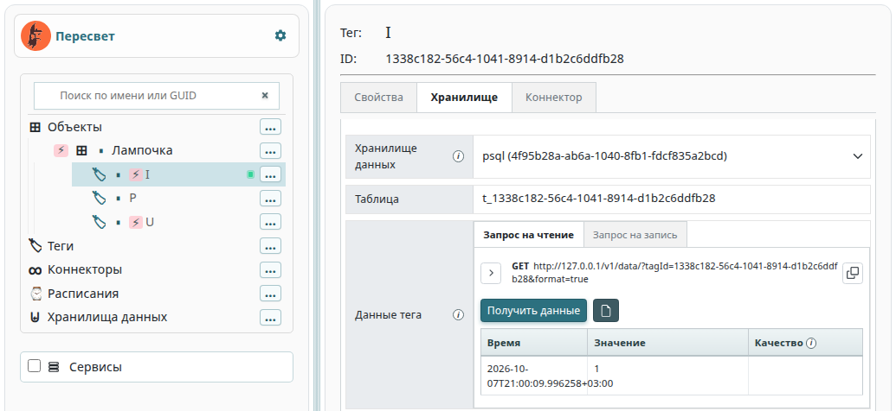
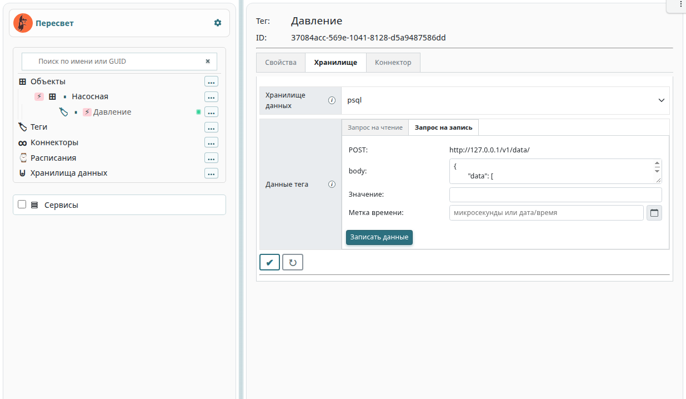

.. _configurator:

Конфигуратор модели
-------------------

Конфигуратор — главная панель Grafana и основной инструмент работы
с моделью. В нём создают и настраивают объекты, теги, тревоги, методы,
коннекторы, расписания и хранилища данных, проверяют данные тегов
и смотрят журналы сервисов платформы.

Всё, что делает конфигуратор, он делает через :ref:`HTTP API <api>`
платформы. Любое действие в нём можно повторить запросом из своей программы.

Как открыть
^^^^^^^^^^^

Запустите платформу (:ref:`installation`) и откройте в браузере
``https://<адрес из PRS_IP>/grafana``. На самом сервере работает и
``https://localhost/grafana``. Сертификат самоподписанный, поэтому браузер
покажет предупреждение.

При первом входе имя и пароль — ``admin`` / ``admin``. Grafana предложит
сменить пароль.

   Слева дерево модели, справа свойства выбранного узла.

Экран разделён на две колонки. Слева сверху — дерево модели, под ним —
блок «Сервисы» с журналами. Справа — свойства узла, выбранного в дереве.
Границы между колонками и между деревом и блоком «Сервисы» можно двигать
мышью.

Дерево модели
^^^^^^^^^^^^^

Корневые папки
______________

На верхнем уровне дерева лежат служебные папки, по одной на вид сущностей.

**Объекты.** Основная иерархия модели. Внутри объекта лежат другие объекты
и теги, у тега — тревоги и методы.

**Теги.** Теги, не привязанные к объектам. Удобно, если модель — просто
список параметров.

**Коннекторы.** Программы, которые приносят данные с оборудования
(:ref:`connectors_guide`). Видеокамера тоже заводится здесь,
как коннектор особого вида (:ref:`video_cameras`).

**Расписания.** Генераторы событий по времени.

**Методы.** Общий каталог методов: определения, на которые потом
ссылаются теги и тревоги (см. :doc:`../methods`). Свои собственные методы
тег и тревога хранят у себя, а не здесь.

**Хранилища данных.** Базы, куда пишется история тегов и события тревог.
Одно из хранилищ можно отметить как хранилище по умолчанию.

**Сервисы.** Не часть модели, а журналы процессов платформы
(см. `Сервисы`_).

Пользовательские папки
______________________

Чтобы разложить узлы по группам, создайте папку командой «Новая папка».
Команда есть у корневых папок «Объекты», «Теги», «Коннекторы»,
«Расписания», «Хранилища данных», «Методы», у объекта и у другой
пользовательской папки.

Что можно положить в папку, зависит от ветки, в которой она лежит:

* в ветке «Объекты» — папки, объекты и теги;
* в ветке «Теги» — папки и теги;
* в остальных ветках — папки и сущности этой ветки: коннекторы,
  расписания, хранилища или методы каталога.

Папку можно вкладывать в другую папку, переименовывать, перетаскивать
и удалять. Удаление папки удаляет и всё её содержимое, поэтому
конфигуратор спрашивает подтверждение. Папки ни на что не влияют, кроме
вида дерева: теги в папке пишут и читают данные так же, как без неё.

Цвет тегов
__________

Значок тега в дереве окрашен по тому, какие методы у него есть:

.. list-table::
   :header-rows: 1
   :widths: 20 80

   * - Цвет
     - Что означает
   * - Зелёный
     - Обычный тег: методов чтения, записи и вычисления нет.
   * - Оранжевый
     - Есть вычислительный метод (тип ``0``).
   * - Бирюзовый
     - Есть метод записи (тип ``2``).
   * - Фиолетовый
     - Есть метод чтения (тип ``1``). Если у тега есть и метод чтения,
       и метод записи, значок тоже фиолетовый.

Методы «Действие при чтении» (тип ``3``) и «Действие при записи» (тип ``4``)
цвет не меняют. Типы методов описаны в разделе `Метод`_.

Пометки в дереве
________________

Значок сразу после значка типа относится к самому узлу.
Значок справа, у кнопки действий, — к узлам внутри ветки.
Подсказка на значке называет проблему.

* **Перечёркнутый круг** — тег или тревога не привязаны к хранилищу,
  история не пишется. Справа: в ветке есть такие узлы.
* **Молния** — у тега нет источника данных: ни коннектора,
  ни дочернего метода. Справа: в ветке есть такие теги.
* **Восклицательный знак** — тег одновременно привязан к хранилищу
  и имеет метод чтения или записи. На чтение или запись отвечают оба,
  платформа берёт ответ, который пришёл первым. Справа: в ветке есть
  такой тег.
* **Бирка с крестом** — у метода параметр «Данные тега(-ов)», но тег
  не выбран. Пустое тело запроса тоже считается незаполненным.
  Значок стоит слева от имени метода, даже если карточка метода закрыта.
  Справа у родителей: в ветке есть такой метод.
* **Пауза** — узел приостановлен. Имя такого узла бледнее.
  Справа: в ветке есть приостановленные узлы.
* **Кружок у коннектора** — состояние связи. Зелёный — коннектор на связи,
  красный — нет, серый — состояние ещё не получено. Конфигуратор
  обновляет его примерно раз в пять секунд. У камеры кружок зелёный,
  пока сервис захвата видео держит соединение с ней.

У хранилища по умолчанию стоит своя пометка. Подсказка на имени любого
узла показывает его описание.

Порядок узлов
_____________

Внутри одного родителя узлы сначала группируются по виду: пользовательские
папки, объекты, теги, тревоги, методы, коннекторы, расписания, хранилища.
Внутри вида порядок задаёт атрибут ``prsIndex``. В настройках можно
включить сортировку по имени.

Поиск
_____

Над деревом есть поле «Поиск по имени или GUID». Список под ним показывает
узлы, у которых совпало имя или идентификатор. Выбор строки раскрывает
ветку до этого узла и выделяет его.

Настройки
^^^^^^^^^

Окно настроек открывает шестерёнка в строке с надписью «Пересвет» над деревом.
Под надписью мелким серым шрифтом показана версия платформы, а сама надпись
открывает эту документацию. Настройки запоминаются в браузере.

**Привязка тегов и тревог к хранилищу по умолчанию при создании.**
Если флажок включён, новый тег или новая тревога сразу привязываются
к хранилищу по умолчанию. Если выключен, узел создаётся без привязки.
Тег типа «Видеопоток» к хранилищу истории не привязывается никогда.

**Сортировка узлов по алфавиту.** Внутри каждого вида узлы сортируются
по имени, а не по ``prsIndex``. Действует сразу и на уже раскрытые ветки.

**Размер шрифта.** Базовый размер шрифта страницы в пикселях: от 10 до 32,
по умолчанию 16. Все надписи конфигуратора масштабируются от него.

Команды узла
^^^^^^^^^^^^

Справа в строке каждого узла есть кнопка «…» — меню команд. В меню только
те команды, которые допустимы для этого узла. Закрыть меню можно клавишей
``Escape`` или щелчком мимо него.

+---------------------------+----------------------------------------------+
| Узел                      | Команды                                      |
+===========================+==============================================+
| Папка «Объекты»           | Новая папка, новый объект                    |
+---------------------------+----------------------------------------------+
| Объект                    | Новая папка, новый объект, новый тег,        |
|                           | копировать, приостановить, удалить           |
+---------------------------+----------------------------------------------+
| Пользовательская папка    | Новая папка и новые узлы, допустимые         |
|                           | в этой ветке; приостановить, удалить         |
+---------------------------+----------------------------------------------+
| Папка «Теги»              | Новая папка, новый тег                       |
+---------------------------+----------------------------------------------+
| Тег                       | Новая тревога, новый метод, копировать,      |
|                           | приостановить, удалить                       |
+---------------------------+----------------------------------------------+
| Тревога                   | Новый метод, копировать,                     |
|                           | приостановить, удалить                       |
+---------------------------+----------------------------------------------+
| Папка «Методы»            | Новая папка, новый метод, загрузка описания  |
+---------------------------+----------------------------------------------+
| Папка внутри «Методы»     | Новая папка, новый метод, загрузка описания, |
|                           | приостановить, удалить                       |
+---------------------------+----------------------------------------------+
| Метод                     | Копировать, приостановить, удалить           |
+---------------------------+----------------------------------------------+
| Папка «Коннекторы»        | Новая папка, новый коннектор                 |
+---------------------------+----------------------------------------------+
| Коннектор                 | Приостановить, удалить                       |
+---------------------------+----------------------------------------------+
| Привязка тега к коннектору| Перейти к тегу, удалить                      |
+---------------------------+----------------------------------------------+
| Папка «Расписания»        | Новая папка, новое расписание                |
+---------------------------+----------------------------------------------+
| Расписание                | Приостановить, удалить                       |
+---------------------------+----------------------------------------------+
| Папка «Хранилища данных»  | Новая папка, новое хранилище                 |
+---------------------------+----------------------------------------------+
| Хранилище                 | Приостановить, удалить                       |
+---------------------------+----------------------------------------------+
| Привязка тега к хранилищу | Перейти к тегу, удалить                      |
+---------------------------+----------------------------------------------+

**Создание.** Новый узел создаётся с параметрами по умолчанию, имя
совпадает с его идентификатором. Свойства нового узла сразу открываются
справа: там его и переименовывают.

**Копировать.** Копия вместе со всеми потомками появляется рядом
с исходным узлом. Если имя занято, платформа подберёт свободное.
Для объекта конфигуратор сначала спрашивает имя копии.

**Приостановить** и **Включить** снимают и ставят признак «Активный»
у узла и у тех его потомков, которые уже раскрыты в дереве. Нераскрытые
ветки не затрагиваются: перед приостановкой раскройте всё, что нужно
выключить.

**Удалить** удаляет узел вместе со всеми потомками.

Копирование, приостановка и удаление требуют подтверждения.

Перетаскивание
^^^^^^^^^^^^^^

Объекты, теги, коннекторы, расписания, хранилища и пользовательские папки
можно переносить мышью. Узел, отпущенный на объект или пользовательскую
папку, становится его потомком. Корневые папки не перетаскиваются.
Перенести узел внутрь самого себя или своей ветки нельзя.

Можно перенести сразу несколько узлов одного вида:

* ``Ctrl`` (на macOS — ``Cmd``) добавляет строку к выделению;
* ``Shift`` выделяет диапазон соседних узлов того же вида;
* перетаскивание любой выделенной строки переносит всю группу;
* обычный щелчок снимает выделение.

Свойства узла
^^^^^^^^^^^^^

Правая колонка показывает имя, идентификатор и поля выбранного узла.
Имя, описание и признак «Активный» есть почти у всех узлов,
остальные поля зависят от вида узла.

Изменённое поле выделяется бирюзовой рамкой. Пока есть несохранённые
правки, под формой доступны две кнопки: галочка записывает изменения
в платформу, стрелка возвращает значения, которые были при открытии узла.

Рядом с подписью поля могут стоять значки: копирование значения
(у имени, описания и конфигурации), краткая подсказка (есть у каждого поля)
и ссылка на документацию. Кнопки копирования имени и идентификатора стоят
в заголовке.

**Поле «Конфигурация»** — редактор JSON. В нём нумеруются строки,
подсвечивается строка с ошибкой и показывается, в какой строке и позиции
ошибка. Кнопки над полем форматируют JSON и сбрасывают правки в поле,
уголок справа внизу растягивает поле по высоте. Пока JSON с ошибкой,
узел не записывается.

**Признак «Активный»** при записи меняется только у этого узла. Чтобы
выключить ветку целиком, используйте команду «Приостановить».

Поля по видам узлов:

* **Объект** — индекс, код типа, конфигурация.
* **Тег** — тип значений (целый, вещественный, строковый, JSON,
  интеграционный, видеопоток), «Обновлять», «Шаговый», значимое отклонение,
  единицы измерения, конфигурация. О «шаговых» тегах —
  в :ref:`правилах работы с историческими данными <timeStampFormat>`.
* **Тревога** — условие сравнения со значением тега (``>=`` или ``<``),
  порог и квитирование: ручное или автоматическое.
* **Метод** — см. `Метод`_.
* **Коннектор** — конфигурация, флажок «Лог в платформу», журнал и команды
  (см. `Коннектор: журнал и команды`_).
* **Расписание** — начало, конец и шаг (в секундах, минутах, часах или днях).
* **Хранилище данных** — признак «по умолчанию», код типа, конфигурация.

Тег: хранилище, коннектор и данные
^^^^^^^^^^^^^^^^^^^^^^^^^^^^^^^^^^

У тега справа есть вкладки **Хранилище** и **Коннектор**, у тревоги —
только **Хранилище**.

**Хранилище.** Тег или тревога пишутся в одно хранилище. Выбор другого
хранилища отвязывает узел от прежнего. На этой же вкладке у тега лежит блок
«Данные тега» (см. ниже). Те же связи видны со стороны хранилищ —
в папке «Хранилища данных».

**Коннектор.** Тег получает данные от одного коннектора. На вкладке задают
описание связи и её конфигурацию в JSON: адрес регистра, топик и другие
параметры, по которым коннектор найдёт значение этого тега в источнике.
Формат конфигурации задаёт конкретный коннектор. Кнопка записи сохраняет
и свойства тега, и эту связь.

Тег «Видеопоток» привязывают к коннектору-камере и к хранилищу видео,
а не к хранилищу истории. Вкладка **Хранилище** у него открывает просмотр
камеры. Подробно — в :ref:`video_cameras`.

Данные тега
___________

Блок «Данные тега» позволяет прочитать и записать значения тега прямо
из конфигуратора. Он есть у тега с выбранным хранилищем и у тега
«Видеопоток».

**Запрос на чтение.** Поля блока соответствуют ключам запроса
:ref:`получения исторических данных <historical_data>`: ``format``, ``actual``,
``start``, ``finish``, ``count``, ``value``, ``timeStep``, ``maxCount``.
У каждого ключа есть подсказка и ссылка на его описание. Для ``start``
и ``finish`` есть календарь и кнопка очистки; в эти поля можно вставить
дату, скопированную из таблицы ответа. Для интеграционного тега есть ещё
поле ``params`` — JSON с параметрами операции (:ref:`integrational_v2`).

Над полями показан готовый запрос ``GET`` с адресом; кнопка рядом копирует
его. Кнопка **Получить данные** выполняет запрос и выводит таблицу
«Время / Значение / Качество». Коды качества описаны в :ref:`qualityCodes`.

**Запрос на запись.** Задайте значение и, при необходимости, метку времени.
Пустая метка означает текущий момент. Метку можно указать целым числом
микросекунд или датой со временем; кнопка календаря подставляет дату
с часовым поясом. Перед отправкой значение приводится к типу тега.
Кнопка **Записать данные** отправляет запрос ``POST /v1/data/``.
У видеопотока этой вкладки нет.

**Экспорт в CSV.** После успешного чтения становится доступна кнопка
**Сохранить в CSV**. Пустой ответ тоже можно сохранить. Любое изменение
запроса, смена тега или ошибка чтения очищают таблицу, и экспорт снова
станет доступен после следующего успешного чтения.

Файл называется ``<имя тега> :: <дата и время сохранения>.csv``. В начале
файла записаны имя и идентификатор тега, полный запрос и значения его
ключей, затем строка заголовка ``x,y,q`` и сами точки. Если в запросе был
ключ ``format``, метки времени ``x`` записываются строками ISO 8601,
иначе — целыми числами микросекунд, как в ответе платформы.

Запрос попадает в файл целиком. Если в адресе есть имя пользователя
и пароль или среди параметров есть что-то похожее на секрет (``token``,
``api_key``, ``password``, ``secret``, ``authorization`` и т.п.),
конфигуратор попросит подтвердить сохранение.

Метод
^^^^^

Метод — программа, которую платформа вызывает для тега или тревоги.
Как устроены и пишутся методы, описано в разделе :doc:`../methods`.
Здесь — только работа с ними в конфигураторе.

Метод создают командой «Новый метод» в меню тега или тревоги. В свойствах
метода поле «Метод/ссылка» определяет, что это будет:

* **новый метод** — свой адрес, список параметров и инициаторы задаются
  прямо у этого метода;
* **ссылка на метод каталога** — адрес и список параметров берутся
  из определения в папке «Методы». Определение выбирается в поле
  «Метод каталога». Адрес у ссылки нельзя изменить.

Поле «Тип» задаёт, когда и зачем вызывается метод:

.. list-table::
   :header-rows: 1
   :widths: 8 26 66

   * - Код
     - Тип
     - Что делает
   * - ``0``
     - Вычислительный
     - Вызывается по событию инициатора: новому значению тега или
       срабатыванию расписания. Результат записывается в тег.
   * - ``1``
     - Чтение
     - Отвечает на чтение тега (``GET /v1/data/``) вместо хранилища.
   * - ``2``
     - Запись
     - Принимает запись в тег (``POST /v1/data/``) и отвечает на неё.
   * - ``3``
     - Действие при чтении
     - Вызывается при каждом чтении тега, но не отвечает на него:
       значение по-прежнему отдаёт хранилище.
   * - ``4``
     - Действие при записи
     - Вызывается при каждой записи в тег, но не отвечает на неё:
       значение по-прежнему принимает хранилище.

Тип есть и у новых методов, и у ссылок. Определение в каталоге всегда
имеет тип ``0``.

**Инициаторы** — две вкладки, «Теги» и «Расписания». Если во вкладке
уже есть выбранные узлы, её фон становится бирюзовым. Слева та же лупа,
что у выбора тега параметра, справа список выбранных узлов. У
вычислительного метода без единого инициатора лупа красная: без тега или
расписания он не запускается. Лупа открывает поиск: узел ищут по имени,
пути или идентификатору и якорем добавляют несколько сразу. Повторное
нажатие снимает выбор. После закрытия диалога
выбранные узлы остаются в списке. Подсказка на каждом — путь, как у
привязки тега к хранилищу, и идентификатор узла.
Новое значение тега-инициатора или срабатывание расписания запускает
метод типа ``0``.

**Параметры** передаются в метод по порядку закладок: первая закладка —
первый аргумент. У параметра есть имя, описание и источник значения:

* **Данные тега(-ов)** — один запрос ``GET /v1/data/`` к выбранным тегам.
  Тегов может быть несколько, все идентификаторы попадают в один запрос.
* **Данные из запроса клиента** — запрос, с которым клиент читает
  родительский тег. Пробный запрос здесь недоступен: запроса клиента ещё нет.
* **Запрос к платформе** — ключ маршрутизации и JSON-сообщение
  внутреннему сервису платформы.
* **Внешний запрос** — произвольный HTTP(S)-запрос: метод, адрес,
  заголовки и тело. В параметр попадает тело ответа; ответ в JSON
  разбирается в объект.

У любого источника к ответу можно применить выражение JSONata. Оно не
входит в сам запрос.

Имя параметра — подпись для человека: при вызове учитывается только
порядок. Номер на закладке — место параметра: первая закладка получает
номер 1.

У ссылки на метод каталога с фиксированным списком параметров число,
имена и описания берутся из каталога и не меняются. У ссылки задают
только источники значений. Если в каталоге включены «Произвольные
параметры», у ссылки свой список: параметров может быть сколько угодно,
их добавляют кнопкой «+».

Если источник «Данные тега(-ов)», лупа слева открывает выбор тегов,
справа остаётся список выбранных. Пока тег не выбран, лупа красная,
а весь серый блок источника светло-розовый: без тега запрос не строится.
Заголовок закладки этого параметра тоже светло-розовый, в том числе
когда закладка открыта.

Подпись **Запрос:** стоит справа от стрелки, с небольшим зазором.
Стрелка раскрывает отдельные поля того же запроса; они остаются под
подписью. У ``start`` и ``finish`` есть календарь. Само поле — JSON-редактор
тела запроса. В него можно дописать любые ключи, например операцию
интеграционного тега. Правый нижний угол поля тянет его высоту.

Строка URL под полем собирается из всего тела и обновляется, как только
JSON снова корректен. Дописанные ключи видны в адресе. Стрелка справа
от адреса выполняет этот же запрос и показывает ответ платформы.
Выражение «JSONata к ответу» в адрес не попадает: оно применяется к
ответу. В иерархию тело записывается объектом ``request``, а выражение —
рядом, в ``responseJsonata``.

**Определение в каталоге** (метод в папке «Методы») задаёт адрес
и список параметров: имя, описание и порядок. Инициаторов
и источников значений у определения нет. Поле «Произвольные параметры»:

* «Нет» — список параметров задан в каталоге, и у всех ссылок он одинаков;
* «Да» — в каталоге параметров нет, их число задают в каждой ссылке.

Команда «Загрузка описания» в меню папки «Методы» загружает целый набор
папок и методов из файла YAML (см. :doc:`../methods`).

Тревога и расписание
^^^^^^^^^^^^^^^^^^^^

Тревога создаётся в меню тега. У неё задают условие (значение тега
``>=`` порога или ``<`` порога) и квитирование. Появление, пропадание
и квитирование тревоги записываются в хранилище, к которому привязана
тревога. Для сложного условия к тревоге добавляют метод.

Расписание задаёт начало, конец и шаг. Метод подписывается на расписание
так же, как на тег: расписание добавляют в его инициаторы.

Коннектор: журнал и команды
^^^^^^^^^^^^^^^^^^^^^^^^^^^

Флажок **Лог в платформу** включает передачу журнала коннектора
в платформу. Ниже две вкладки.

**Лог коннектора** — последние строки журнала. Пауза останавливает
обновление на экране, но платформа продолжает принимать строки. Кнопка
со стрелкой вниз сохраняет видимый текст в файл.

**Команды коннектору** — команды оболочки, которые коннектор выполнит
на своей машине, по одной на строку. Под полем видны ответ платформы
и вывод, который вернул коннектор. Подробнее — в :ref:`connectors_guide`.

У камеры этой вкладки нет: поворотом и параметрами изображения управляют
у тега видеопотока (:ref:`video_cameras`).

Хранилища данных
^^^^^^^^^^^^^^^^

Папка «Хранилища данных» справа показывает карточки всех хранилищ.
Под хранилищем в дереве перечислены привязанные к нему теги. Привязка
названа путём тега в иерархии: объекты и папки до тега, разделённые
стрелкой ``→``.

Щелчок по привязке открывает её параметры. У хранилища истории это таблица,
у видеоархива — каталог и срок хранения. Те же сведения есть на вкладке
**Хранилище** в свойствах тега.

У привязки к интеграционному хранилищу задают операции чтения и записи:
имя, описание, выражения параметров и признак операции по умолчанию.
Первая созданная операция чтения и первая операция записи сразу становятся
операциями по умолчанию. Операции сохраняются отдельной кнопкой
**Записать операции (v2)**. Подробно — в :ref:`integrational_v2`.

В меню привязки две команды: **Перейти к тегу** раскрывает тег в иерархии
объектов, **Удалить** снимает привязку, не удаляя сам тег. Привязки тегов
к коннектору устроены так же.

Сервисы
^^^^^^^

Папка «Сервисы» под деревом показывает журналы процессов платформы.
У каждого сервиса есть флажок «Показывать лог сервиса» и число
подключённых обработчиков очереди. Справа выводятся последние строки
журналов отмеченных сервисов.

Пауза останавливает обновление на экране, корзина очищает журналы
выбранных сервисов, стрелка вниз сохраняет видимый текст в файл.

Дальше
^^^^^^

Модель с нуля по шагам собирается в
`базовом курсе <https://github.com/mp-co-ru/prs-peresvet-courses/tree/main/01.base>`_.
Подключение камеры — в :ref:`video_cameras`.
