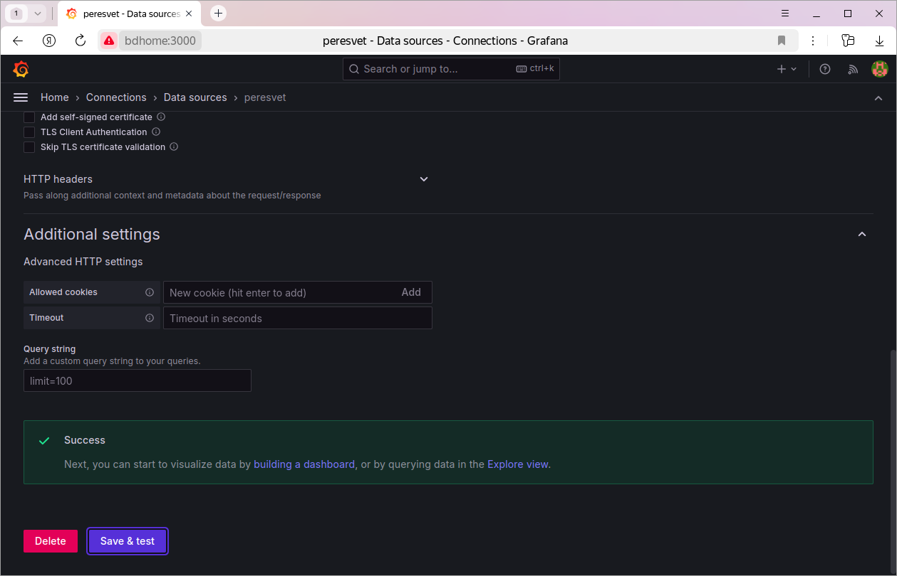
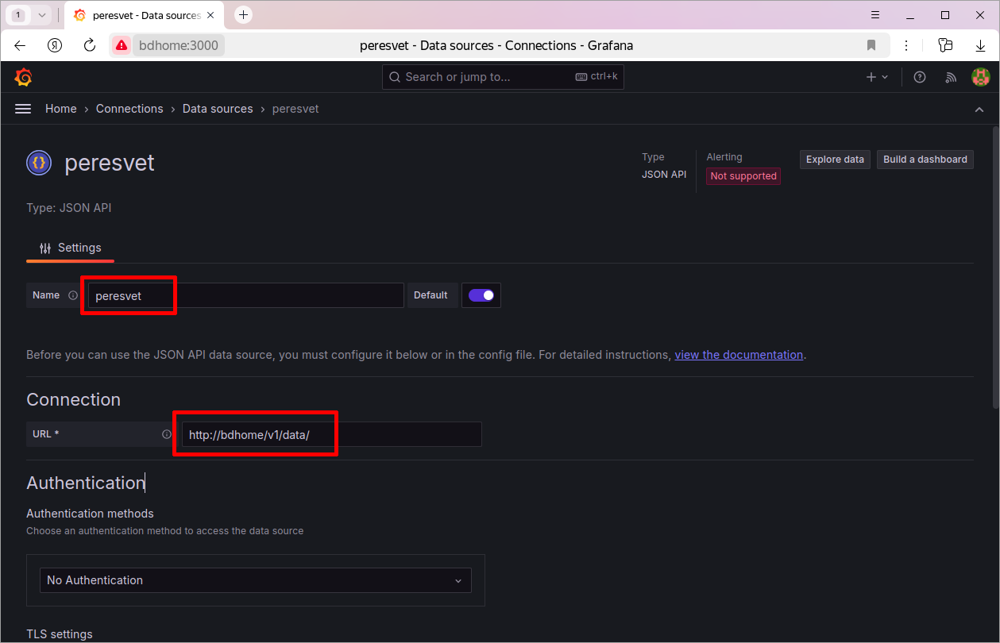
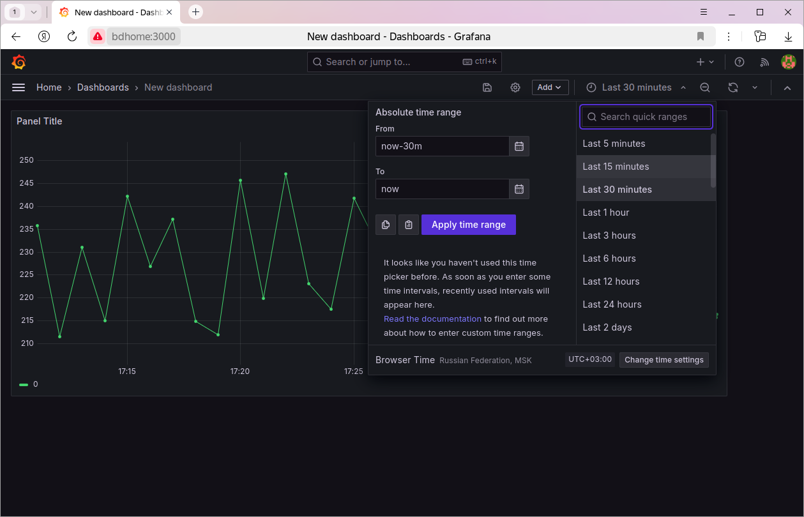

Создание экранов в Grafana
==========================

Экраны мониторинга строятся в той же Grafana, где работает конфигуратор.
Данные тегов Grafana получает от платформы запросом
``GET /v1/data/`` (см. :ref:`historical_data`) через плагин источника
данных JSON API. Ниже по шагам построен тренд одного тега.

Подготовка
----------

#. Установите и запустите платформу (:ref:`installation`).
#. Соберите модель: тег, привязанный к хранилищу, в котором уже есть
   история. Как это сделать, показано в
   `базовом курсе <https://github.com/mp-co-ru/prs-peresvet-courses/tree/main/01.base>`_.
#. Откройте ``https://<адрес из PRS_IP>/grafana`` и войдите
   (при первом входе — ``admin`` / ``admin``).

Источник данных
---------------

Плагин JSON API и источник данных ``peresvet`` на его основе создаются при
установке платформы. Источник ``peresvet`` выбран источником по умолчанию,
его адрес — ``http://<имя сервера>/v1/``.

Проверьте источник: откройте меню Grafana, раздел
**Connections → Data sources → peresvet**, и нажмите **Save & test**.

Если проверка не проходит, поправьте адрес в поле **URL**: укажите
``https://<адрес сервера>/v1/``, а для самоподписанного сертификата
включите в настройках TLS пропуск проверки сертификата.

Второй источник, например для другого сервера платформы, создаётся так же:
**Connections → Add new connection → JSON API → Add new data source**.
Имя источника может быть любым, в **URL** укажите адрес API платформы.

Тренд тега
----------

Пусть в модели есть тег с идентификатором
``58993cd8-f3e9-103e-97a9-c54148266c5f``, и в хранилище есть его история.

#. Создайте новый экран (dashboard) и на нём новую панель
   (visualization):

   .. image:: pics/07.new_dashboard.png

   .. image:: pics/08.new_panel.png

#. Выберите источник данных ``peresvet``:

   .. image:: pics/09.select_ds.png

   Откроется редактор панели. Тип панели — **Time series**:

   .. image:: pics/10.panel_settings.png

#. На вкладке **Path** запроса укажите путь к API данных относительно
   адреса источника. Для источника ``peresvet`` с адресом ``.../v1/`` это
   ``data/``:

   .. image:: pics/11.set_path.png

#. На вкладке **Params** добавьте параметр запроса ``q`` со значением:

   .. code:: json

      {"tagId":"58993cd8-f3e9-103e-97a9-c54148266c5f","format":true,"start":"$__isoFrom()","finish":"$__isoTo()"}

   ``$__isoFrom()`` и ``$__isoTo()`` — функции Grafana. Они подставляют
   начало и конец периода, выбранного на экране, в формате ISO 8601.
   Остальные ключи запроса описаны в разделе :ref:`historical_data`.

   .. image:: pics/12.set_params.png

#. Проверьте, что платформа отвечает: нажмите **Query inspector**,
   затем **Refresh**. В ответе должен быть массив точек тега:

   .. image:: pics/13.query_inspector.png

   .. image:: pics/14.refresh.png

   .. image:: pics/15.got_data.png

#. Объясните Grafana, где в ответе время, а где значение. Платформа отдаёт
   каждую точку массивом ``[x, y, q]``: метка времени, значение,
   код качества. На вкладке **Fields** добавьте два поля с типом выражения
   **JSONPath**:

   .. list-table::
      :header-rows: 1
      :widths: 50 20

      * - Field
        - Type
      * - ``$.data[0].data[*][0]``
        - Time
      * - ``$.data[0].data[*][1]``
        - Number

   .. image:: pics/16.fields.png

   .. note::

      Скриншот сделан в версии платформы, где точка имела вид
      ``[y, x, q]``, поэтому индексы на нём переставлены. Ориентируйтесь
      на таблицу.

#. Нажмите **Apply**. На панели появится тренд тега:

   .. image:: pics/17.trend.png

Период и частоту обновления можно менять в правом верхнем углу экрана:
Grafana будет каждый раз запрашивать данные за новый период.

