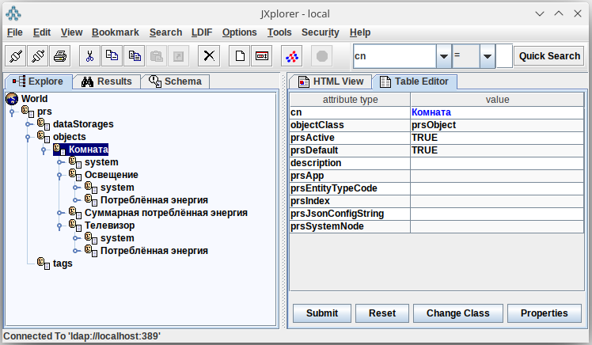

Методы
======

Метод — программа, которую платформа вызывает, чтобы модель что-то сделала:
посчитала значение тега, ответила на чтение тега, приняла запись, вызвала
внешнюю систему. Методы и составляют динамическую модель объекта.

Как устроен вызов
-----------------

Код метода выполняется не внутри платформы, а в отдельном процессе —
**исполнителе** (worker). Исполнитель подключается к RabbitMQ платформы
и регистрирует свои функции под строковыми адресами, например ``sum``
или ``prs.stdlib.add``. Для вызова используется библиотека
`patio <https://pypi.org/project/patio/>`_ с транспортом
`patio-rabbitmq <https://pypi.org/project/patio-rabbitmq/>`_.

В модели метод — это узел под тегом или тревогой. В узле записаны:

* **адрес** (``prsMethodAddress``) — под каким именем функция
  зарегистрирована в исполнителе;
* **тип** (``prsEntityTypeCode``) — когда вызывается метод, см. `Типы методов`_;
* **инициаторы** — теги и расписания, события которых запускают
  вычислительный метод;
* **параметры** — откуда взять значение каждого аргумента функции,
  см. `Параметры`_.

Когда наступает событие, сервис методов вычисляет значения параметров,
сортирует их по ``prsIndex`` и вызывает функцию по адресу, передавая
значения позиционными аргументами.

Если метод не может или не должен вернуть результат (ошибка в данных,
нового значения нет), функция возвращает словарь с ключом ``error``.
Значение ключа может быть любым: платформа запишет его в журнал,
а значение тега не изменит.

Типы методов
------------

.. list-table::
   :header-rows: 1
   :widths: 8 22 70

   * - Код
     - Тип
     - Когда вызывается и что делает
   * - ``0``
     - Вычислительный
     - Вызывается для каждого нового значения тега-инициатора и при каждом
       срабатывании расписания-инициатора. Результат записывается в тег,
       которому принадлежит метод, с меткой времени события.
   * - ``1``
     - Чтение
     - Вызывается при чтении тега (``GET /v1/data/``). Результат
       возвращается клиенту как значение тега на момент ``finish``
       запроса (или на текущий момент).
   * - ``2``
     - Запись
     - Вызывается при записи в тег (``POST /v1/data/``). Последним
       аргументом функция получает записываемые точки. Если функция
       не вернула ``error``, запись считается успешной.
   * - ``3``
     - Действие при чтении
     - Вызывается при чтении тега так же, как тип ``1``, но ответ клиенту
       не формирует: значение отдаёт хранилище. Ошибка действия
       записывается в журнал и на ответ не влияет.
   * - ``4``
     - Действие при записи
     - Вызывается при записи в тег так же, как тип ``2``, но на запись
       не отвечает: точки сохраняет хранилище. Если у тега нет ни хранилища,
       ни метода типа ``2``, платформа сама подтверждает запись после
       выполнения действия.

Чтение и запись тега с методами типов ``1`` и ``2`` устроены так. Платформа
рассылает одно сообщение о чтении (или записи) и ждёт **один** ответ.
Если тег привязан и к хранилищу, и к методу типа ``1`` (или ``2``),
ответят оба, и платформа возьмёт тот ответ, который придёт первым.
Поэтому тег с методом чтения или записи обычно к хранилищу не привязывают;
конфигуратор отмечает такое сочетание красным значком. У типов ``3`` и ``4``
этой проблемы нет: они не отвечают.

Пример вычислительного метода
-----------------------------

В комнате два потребителя электроэнергии: освещение и телевизор. У каждого
есть тег «Потреблённая энергия», значения приходят с приборов учёта.
У комнаты есть тег «Суммарная потреблённая энергия», который должен
пересчитываться каждый раз, когда приходит новое значение от любого
из потребителей.

    Иерархия объектов и тегов примера

Исполнитель
~~~~~~~~~~~

Напишем исполнитель на Python. Нужны пакеты ``patio`` и ``patio-rabbitmq``:

.. code-block:: python
   :linenos:

   import asyncio
   from patio import Registry, AsyncExecutor
   from patio_rabbitmq import RabbitMQBroker

   rpc = Registry(project="methods_app", auto_naming=False)

   def last_value(response: dict):
       """Значение из ответа GET /v1/data/ на один тег."""
       return response["data"][0]["data"][0][1]

   @rpc("sum")
   async def sum_energy(a: dict, b: dict):
       try:
           val_a = last_value(a) or 0
           val_b = last_value(b) or 0
       except (KeyError, IndexError, TypeError) as ex:
           return {"error": f"нет данных: {ex}"}
       return val_a + val_b

   async def main():
       async with AsyncExecutor(rpc, max_workers=16) as executor:
           async with RabbitMQBroker(
               executor,
               # адрес RabbitMQ платформы
               amqp_url="amqp://<пользователь>:<пароль>@<сервер>/",
           ) as broker:
               await broker.join()

   if __name__ == "__main__":
       asyncio.run(main())

Обратите внимание:

* Проект в ``Registry`` должен называться ``methods_app`` — так называется
  сервис методов платформы.
* Функция зарегистрирована под адресом ``sum`` (строка 13). Этот адрес
  указывают в узле метода.
* Каждый аргумент получает ответ платформы на запрос
  :ref:`исторических данных <historical_data>` по одному тегу:
  ``{"data": [{"tagId": "...", "data": [[x, y, q]]}]}``. Функция
  ``last_value`` достаёт из него значение ``y``.

Исполнитель запускают как обычную программу на любой машине, откуда
доступен RabbitMQ платформы (порт ``5672``). Исполнителей может быть
несколько: каждый регистрирует свои адреса.

Узел метода
~~~~~~~~~~~

Теперь создадим узел метода под тегом «Суммарная потреблённая энергия».
Для краткости пусть идентификаторы тегов такие:

* ``1`` — «Суммарная потреблённая энергия» комнаты;
* ``2`` — «Потреблённая энергия» освещения;
* ``3`` — «Потреблённая энергия» телевизора.

Запрос ``POST /v1/methods/``:

.. code-block:: json

   {
      "parentId": "1",
      "attributes": {
         "cn": "Сумма",
         "prsMethodAddress": "sum",
         "prsEntityTypeCode": 0
      },
      "initiatedBy": ["2", "3"],
      "parameters": [
         {"attributes": {"prsIndex": 1, "prsJsonConfigString": {"tagId": "2"}}},
         {"attributes": {"prsIndex": 2, "prsJsonConfigString": {"tagId": "3"}}}
      ]
   }

Здесь:

* ``parentId`` — тег, в который пишется результат;
* ``prsMethodAddress`` — адрес функции в исполнителе;
* ``initiatedBy`` — теги, новые значения которых запускают расчёт;
* ``parameters`` — аргументы функции по порядку ``prsIndex``. Каждый
  параметр здесь — запрос данных тега.

В запрос данных тега платформа сама подставляет ``finish``, равный метке
времени нового значения инициатора. Поэтому метод получает значения
обоих тегов на один и тот же момент, а результат записывается в тег ``1``
с той же меткой.

То же самое можно сделать в :ref:`конфигураторе <configurator>`: команда
«Новый метод» в меню тега, затем адрес, инициаторы и параметры в свойствах.

Параметры
---------

Как вычислить значение параметра, задаёт JSON в атрибуте
``prsJsonConfigString`` параметра. Возможны такие варианты.

**Данные тега.** Тело запроса :ref:`исторических данных <historical_data>`
с ключом ``tagId``. Значение ключа — идентификатор тега или список
идентификаторов: платформа выполняет один ``data_get`` сразу по всем
указанным тегам. При запуске по событию платформа подставляет ``finish``
равным метке времени события, при чтении тега — ``finish`` из запроса
клиента. Ключ ``responseJsonata`` задаёт выражение JSONata, которое
применяется к ответу:

.. code-block:: json

   {"tagId": "<id тега>", "responseJsonata": "data[0].data[0][1]"}

**Запрос клиента.** Объект запроса, которым клиент читает тег. Нужен
методам чтения: так метод узнаёт, за какой период и с какими ключами
спрашивают тег. Ключ ``clientJsonata`` выбирает из запроса нужную часть;
без него в параметр попадает весь запрос:

.. code-block:: json

   {"clientJsonata": "$.finish"}

Если метод запущен событием, а не чтением, вместо запроса клиента
используется объект ``{"finish": ..., "start": null, "point": {"x": ..., "y": ..., "q": ...}}``
с новым значением инициатора.

**Запрос к платформе.** Произвольное внутреннее сообщение сервису
платформы: ключ маршрутизации ``routingKey``, тело ``message`` и
необязательное ``responseJsonata``. Например, так метод получает
атрибуты узла иерархии:

.. code-block:: json

   {
     "routingKey": "prsTag.api_crud.read.*",
     "message": {"id": ["<id тега>"], "attributes": ["prsJsonConfigString"]},
     "responseJsonata": "data[0].attributes"
   }

**Внешний HTTP-запрос.** Объект ``httpRequest`` с полями ``method``
(``GET``, ``POST``, ``PUT``, ``PATCH``, ``DELETE``, ``HEAD``), ``url``
(только ``http://`` и ``https://``), необязательными ``headers`` и ``body``.
В параметр попадает тело ответа; ответ в JSON разбирается в объект.
Ответ больше 1 МБ, ответ с кодом не из диапазона ``2xx`` и ожидание
дольше 20 секунд считаются ошибкой. Перенаправления не выполняются.

.. code-block:: json

   {
     "httpRequest": {"method": "GET", "url": "https://example.com/api/rate"},
     "responseJsonata": "rate"
   }

**Привязка.** Короткая форма, которую обычно используют у ссылок
на методы каталога (см. ниже):

* ``{"binding": "tag", "tagId": "<id>"}`` — значение тега, как в варианте
  «Данные тега»;
* ``{"binding": "literal", "value": 1, "valueTypeCode": 2}`` — постоянное
  значение; ``valueTypeCode``: ``1`` целое, ``2`` вещественное,
  ``3`` строка, ``4`` JSON;
* ``{"binding": "constant", "constantId": "<id>"}`` — значение константы
  модели.

Каталог методов
---------------

Один и тот же метод часто нужен многим тегам: сложение, среднее, перевод
единиц. Чтобы не повторять адрес и список параметров в каждом теге,
определение метода кладут в **каталог** — папку «Методы» в конфигураторе
(узел ``cn=methods,cn=prs``), а у тегов и тревог создают **ссылки** на него.

Определение в каталоге
~~~~~~~~~~~~~~~~~~~~~~

Определение задаёт адрес и список параметров: имя, описание и порядок
(``prsIndex``). Имя нужно только человеку: при вызове учитывается
порядок параметров. Тип значения платформа не задаёт и не проверяет.
Инициаторов и источников значений у определения нет, тип определения
всегда ``0``.

Запрос ``POST /v1/methods/``:

.. code-block:: json

   {
     "parentId": "<id папки каталога или пусто для корня>",
     "attributes": {
       "cn": "add",
       "prsMethodAddress": "prs.stdlib.add",
       "prsEntityTypeCode": 0
     },
     "parameters": [
       {"attributes": {"cn": "a", "prsIndex": 1, "prsValueTypeCode": 2}},
       {"attributes": {"cn": "b", "prsIndex": 2, "prsValueTypeCode": 2}}
     ]
   }

Если у определения задан атрибут ``prsVariadic: true`` («Произвольные
параметры» в конфигураторе), список параметров в каталоге не хранится.
Тогда каждая ссылка сама задаёт, сколько у неё параметров и какие,
а платформа не проверяет их число. При чтении определения поле
``parameterCount`` показывает число параметров.

Определения раскладывают по папкам. Папка каталога создаётся тем же
запросом с флагом ``folder`` (см. :doc:`folders`):

.. code-block:: json

   {"folder": true, "attributes": {"cn": "Арифметика"}}

Удаление папки удаляет вложенные папки и определения.

Ссылка на определение
~~~~~~~~~~~~~~~~~~~~~

Ссылка — узел метода под тегом или тревогой с полем ``catalogMethodId``.
У ссылки свои тип (``0``–``4``), инициаторы и источники значений
параметров, а адрес берётся из каталога:

.. code-block:: json

   {
      "parentId": "<id тега>",
      "catalogMethodId": "<id определения в каталоге>",
      "attributes": {"cn": "Сумма комнаты", "prsEntityTypeCode": 0},
      "initiatedBy": ["<id тега-инициатора>"],
      "parameters": [
         {"attributes": {"prsIndex": 1, "prsJsonConfigString": {"binding": "tag", "tagId": "<id>"}}},
         {"attributes": {"prsIndex": 2, "prsJsonConfigString": {"binding": "literal", "value": 1, "valueTypeCode": 2}}}
      ]
   }

Правила:

* Адрес вызова каждый раз читается из каталога: если адрес в определении
  изменили, ссылки сразу вызывают новый.
* Источник значения параметра у ссылки задаётся любым из вариантов
  раздела `Параметры`_.
* Перед вызовом платформа проверяет, что число параметров совпадает
  с определением. Тип значения не проверяется. При ``prsVariadic``
  не проверяется и число.
* Определение, на которое есть ссылки, удалить нельзя (ответ ``409``).
  То же относится к папке, в которой оно лежит.
* Ссылку можно копировать, определение — копировать внутри каталога.
  Скопировать определение под тег или тревогу нельзя (ответ ``422``):
  для этого создают ссылку.

Загрузка описания
~~~~~~~~~~~~~~~~~

Набор папок и методов можно загрузить в каталог одним файлом YAML.
В конфигураторе это команда «Загрузка описания» в меню папки «Методы»
или вложенной папки, через API — ``POST /v1/methods/description``
с полями ``yaml`` (текст описания), ``parentId`` (папка) и ``probe``.

.. code-block:: yaml

   folders:
     - cn: stdlib
       description: Стандартные арифметические методы
       methods:
         - cn: add
           address: prs.stdlib.add
           description: Сложение
           parameters:
             - {cn: a, type: float}
             - {cn: b, type: float}
           probe: [2, 3]
   methods:
     - cn: echo
       address: prs.example.echo
       parameters:
         - {cn: text, type: string}

У метода обязателен адрес (``address`` или ``prsMethodAddress``).
Параметр описывают поля ``cn``, ``index`` и ``type`` (``int``, ``float``,
``string``, ``json`` или код ``1``–``4``). Метод с адресом, который уже есть
в каталоге, повторно не создаётся. В ответе перечислено, какие папки
и методы созданы. При ``probe: true`` платформа после загрузки пробно
вызывает каждый метод с аргументами из ``probe`` и сообщает результат.
Полный пример — ``docs/source/samples/methods/methodDescription.yaml``.

Пакеты методов
~~~~~~~~~~~~~~

Пакет методов — это исполнитель вместе с YAML-описанием его адресов.
Платформа не загружает пакеты сама: описание отправляют в каталог
через API или конфигуратор, а исполнитель запускают отдельно.

В репозитории лежит пример пакета — ``methods/packages/stdlib``: сложение,
вычитание, умножение и деление по адресам ``prs.stdlib.add``,
``prs.stdlib.sub``, ``prs.stdlib.mul``, ``prs.stdlib.div``. В поставку он
не входит. Запуск исполнителя:

.. code-block:: bash

   python methods/packages/stdlib/worker.py

Адрес RabbitMQ исполнитель берёт из переменной окружения ``amqp_url``.
Аргументы он принимает и числами, и ответами ``GET /v1/data/``.
Если аргумент отсутствует, не число или делитель равен нулю,
он возвращает ``{"error": "..."}``, и значение тега не записывается.

Примеры тел запросов лежат в ``docs/source/samples/methods/``:
``addMethodFolderIn.txt``, ``addCatalogMethodIn.txt``,
``addCatalogInstanceIn.txt``.
